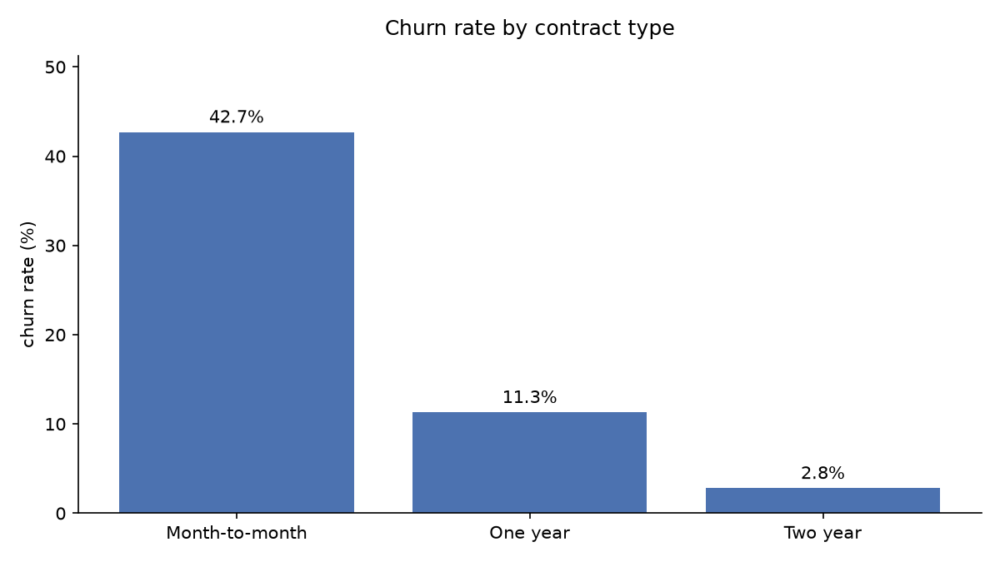
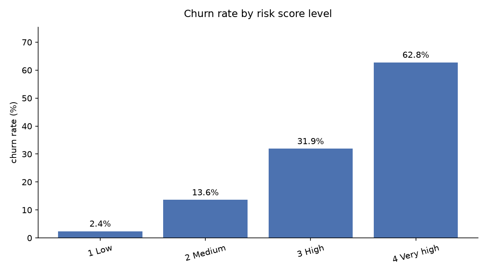
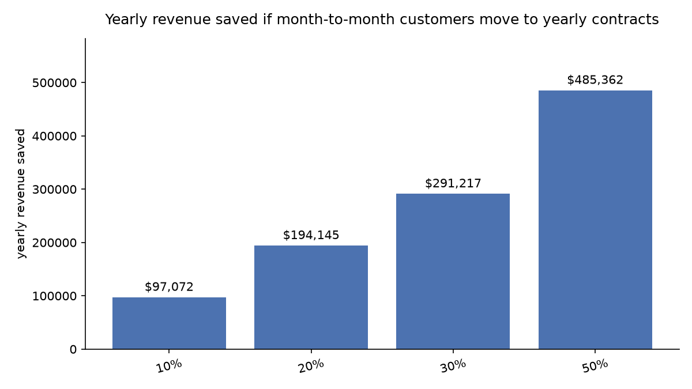

# Telecom Customer Churn Analysis (SQL + Python)

**Business question:** a telecom company is losing customers. *Who* is leaving,
*why*, *how much money* does it cost, and **which current customers should the
company call this week to stop them leaving?**

"Churn" means a customer cancelling their service. Every subscription business
(telecom, banks, streaming, software) tracks it, because keeping a customer is
cheaper than finding a new one.

## Data

[IBM's Telco Customer Churn dataset](https://github.com/IBM/telco-customer-churn-on-icp4d):
7,043 customers of a telecom company, with their contract, services, monthly
bill, and whether they left. It's a sample dataset IBM publishes for analytics
training, built to look like real company data.

## How it works (3 steps)

```
1_download_data.py   →  downloads the CSV
2_clean_data.py      →  cleans it with pandas, splits it into 3 tables, saves to a SQLite database
3_run_analysis.py    →  runs the 10 SQL questions, saves results and charts
```

**Cleaning done in step 2:**
- 11 new customers had a blank `TotalCharges`, so it's set to 0
- `SeniorCitizen` changed from 1/0 to Yes/No
- "No internet service" / "No phone service" simplified to "No"
- churn turned into a 1/0 column, so churn rate = the average of that column
- added tenure groups (0-12, 13-24, 25-48, 49-72 months)
- split the data into 3 tables like a real company database: `customers`, `services`, `accounts`

## Key findings

| # | Question | Answer |
|---|---|---|
| 1 | How many customers left? | **26.5%** (1,869 of 7,043) |
| 2 | Does contract type matter? | Month-to-month: **42.7%** leave. Two-year contract: only **2.8%** |
| 3 | When do customers leave? | **47%** of first-year customers leave; after 4 years only 9.5% |
| 4 | Does payment method matter? | Electronic check: **45%** leave vs 15-19% for other methods |
| 5 | Which internet service? | Fiber optic customers leave most (**42%**) despite paying the most |
| 6 | How much money is lost? | **30.5%** of monthly revenue, about **$1.67M a year** |
| 7 | Do support services help? | Without tech support or security: **49%** leave. With both: **9%** |
| 8 | Which customers are most at risk? | Seniors living without dependents: **43%** |
| 9 | Riskiest group? | Month-to-month + fiber + electronic check: **60%** leave (1,307 customers) |
| 10 | Churned vs stayed? | Churned customers paid **more** per month ($74 vs $61) but stayed half as long |



## Going further: from "why" to "what to do"

Most churn analyses stop at *why customers left*. This one also answers
*what the company should do next*.

### 1. A churn risk score for every customer

Built in SQL ([views/customer_risk.sql](views/customer_risk.sql)) from the
patterns found above:

| Risk factor | Points |
|---|---|
| Month-to-month contract (one-year: 1) | 3 |
| Customer for 12 months or less (13-24 months: 1) | 2 |
| Pays by electronic check | 2 |
| Fiber optic internet | 2 |
| No tech support | 1 |
| No online security | 1 |
| Senior citizen | 1 |

**Does it work?** Yes. Churn rises sharply with the score:

| Risk level | Score | Customers | Churn rate |
|---|---|---|---|
| Low | 0-2 | 1,923 | **2.4%** |
| Medium | 3-5 | 1,773 | **13.6%** |
| High | 6-8 | 1,686 | **31.9%** |
| Very high | 9-12 | 1,661 | **62.8%** |



### 2. A "save list" for the retention team

[results/13_save_list.csv](results/13_save_list.csv) lists the **1,766 customers
who are still active but high or very high risk**, sorted with the riskiest and
highest-paying first. That's a ready-made call list.

Together they bring in **$131k a month, about $1.57M a year**, revenue the
company can still protect.

### 3. A "what if" scenario

If the company convinced some month-to-month customers to switch to a one-year
contract (which has an 11.3% churn rate instead of 42.7%):

| Customers moved | Customers kept | Revenue saved per year |
|---|---|---|
| 10% | 122 | $97k |
| 20% | 244 | **$194k** |
| 30% | 365 | $291k |
| 50% | 609 | $485k |



**Honest limits:** the risk points were chosen from patterns in this same data,
so a real company would test the score on new customers before trusting it.
The scenario assumes customers who switch behave like today's one-year
customers, which is an estimate, not a guarantee.

## Recommendations

1. **Call the save list first:** 1,766 active high-risk customers worth $1.57M a year.
2. **Move month-to-month customers to yearly contracts** (e.g. a discount for committing). Moving just 20% saves about $194k a year.
3. **Focus on the first year.** Almost half of new customers leave, so onboarding matters most.
4. **Push automatic payments.** Electronic-check users leave 3x more often.
5. **Bundle tech support and online security** for fiber customers, the highest-paying and most likely to leave.

## SQL skills used

`GROUP BY` and aggregates · `JOIN` across 3 tables · `CASE WHEN` · `HAVING` ·
CTE (`WITH`) · window function (`RANK() OVER`) · `CREATE VIEW` · `VALUES` + `CROSS JOIN` for scenarios

## Run it yourself

```bash
python -m venv .venv
.venv\Scripts\activate
pip install -r requirements.txt
python 1_download_data.py
python 2_clean_data.py
python 3_run_analysis.py
```

## Files

| File / folder | What it is |
|---|---|
| `1_download_data.py` | downloads the raw data |
| `2_clean_data.py` | cleans the data and builds the database |
| `3_run_analysis.py` | builds the risk score, runs the SQL questions, saves results and charts |
| `views/customer_risk.sql` | the churn risk score |
| `queries/` | the 14 SQL questions, one file each |
| `results/` | the answer to each question (CSV), including the save list |
| `charts/` | 6 bar charts |
| `data/clean/` | the 3 clean tables as CSV (used for the Power BI dashboard) |
| `churn.db` | the SQLite database |

## Next

A Power BI dashboard built on `data/clean/`.
